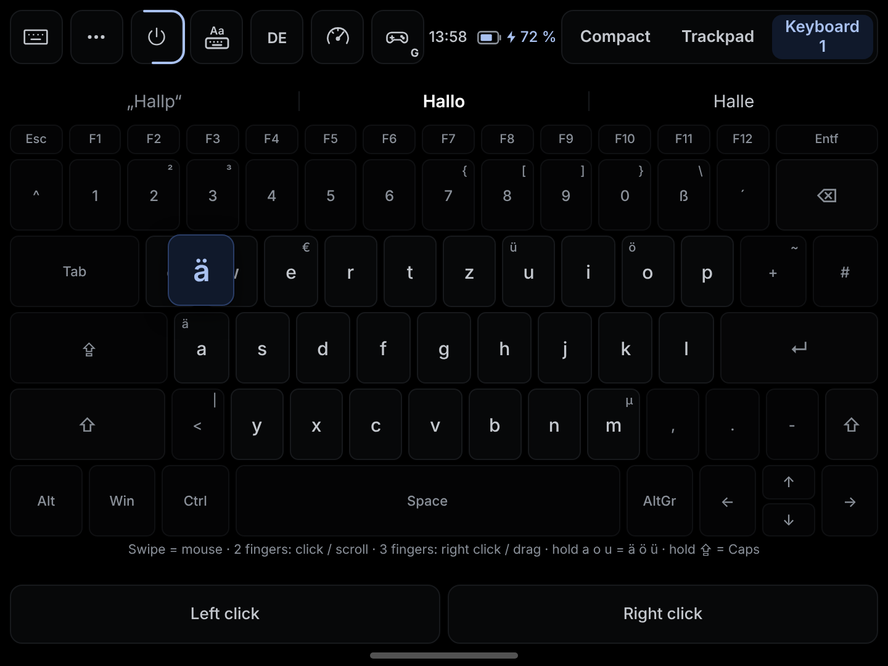
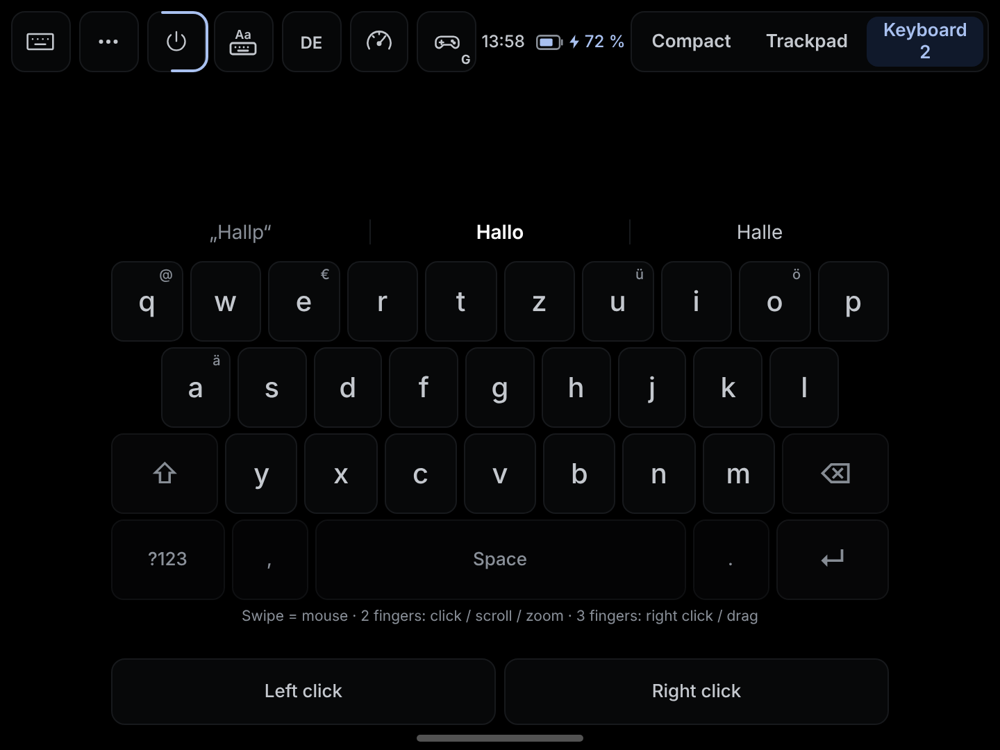
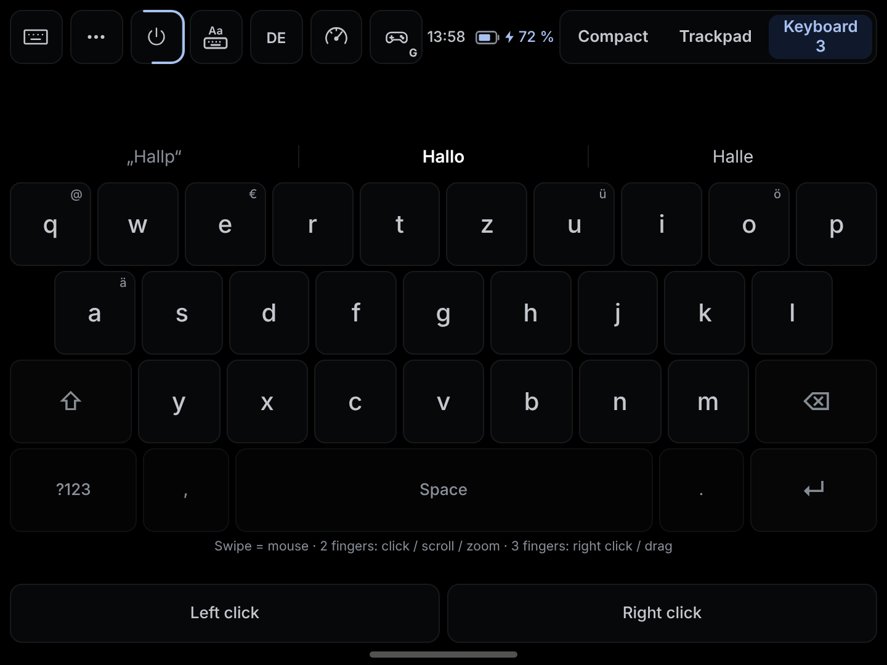
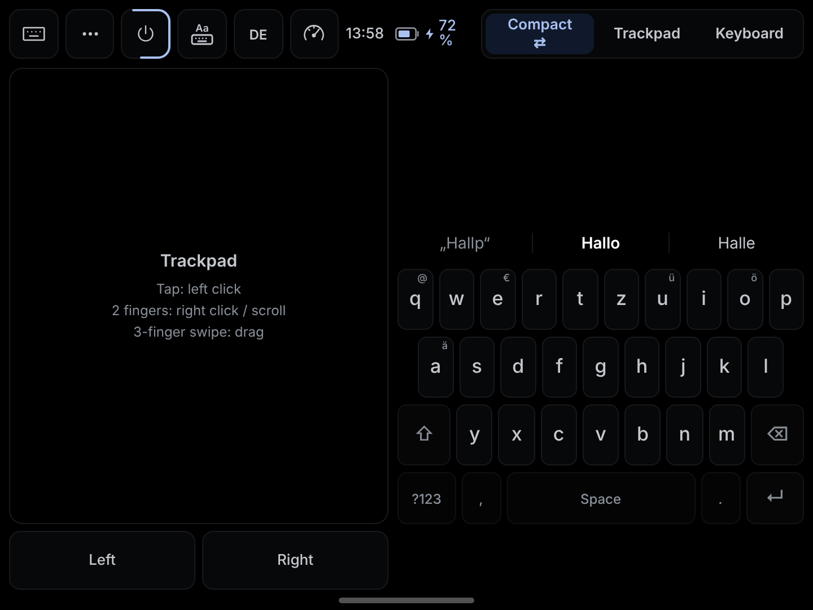
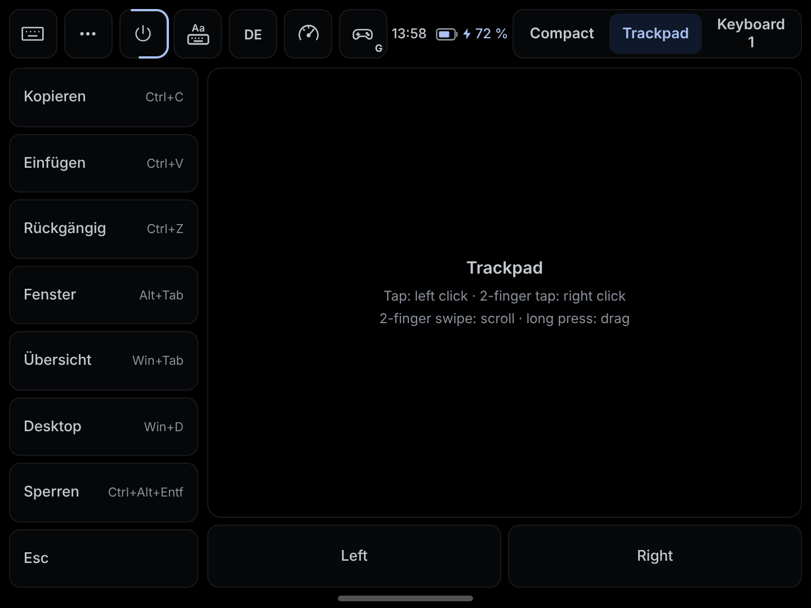
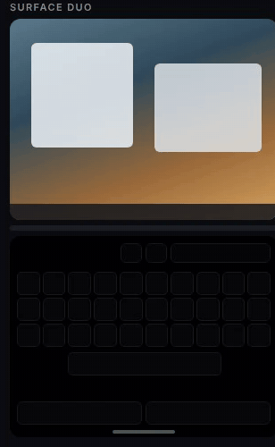
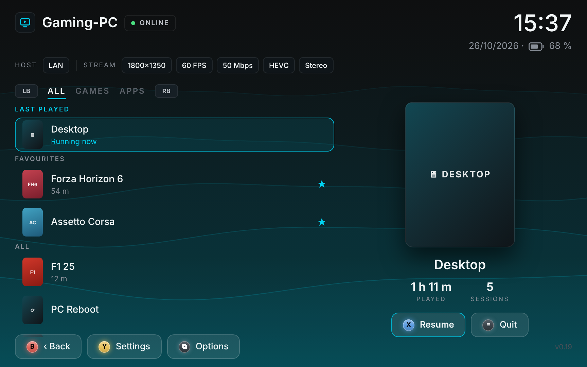
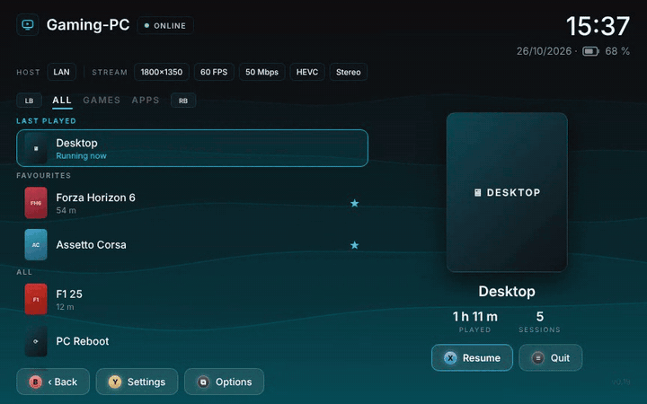

# Artemide Duo

**Who needs a brand-new foldable iPhone when the Surface Duo is the perfect streaming client?**
Two screens, one hinge: your PC on the upper screen, a real keyboard and trackpad on the lower one. Artemide Duo turns a Surface Duo into a pocket laptop for your gaming PC and your desktop.

Artemide Duo is [Artemide](https://github.com/derflacco/moonlight-android) with a new interface, built from the ground up for **gamepad and touchscreen**. Every screen can be driven with a controller or by touch. The look is inspired by [StreamLight](https://github.com/FoggyBytes/StreamLight).

Works great on the **Surface Duo** and on **all 16:10 devices** (e.g. Galaxy Tab S6).

> **Heads-up:** these builds are explicitly for testing. Expect rough edges, and please report what you find.

## The keyboard

The keyboard is the heart of Artemide Duo. It lives on the second screen, slides in from the hinge and doubles as a trackpad: swipe to move the mouse, tap to type.

| Normal | Slim | Wide (ten-finger) |
|---|---|---|
|  |  |  |

| Compact (one hand, with trackpad) | Trackpad | Appear / hide animation |
|---|---|---|
|  |  |  |

- Gboard-style autocorrect, suggestions and next-word prediction (German / English) that learn your phrases.
- Backspace into a word picks the whole word up again.
- Laptop gestures: tap = click, two fingers = scroll / right click, three fingers = drag, pinch = zoom.
- Adjustable haptics.

<sub>Screens are renders from the design files; the app on your device may differ in details.</sub>

## App overview





Games and apps tabs, favourites, last played, play time, a gliding selection ring and a soft cover backdrop. Everything works with a controller: LB / RB switch tabs, A opens, X adds a favourite.

## Download

Get the latest APK from **[Releases](../../releases/latest)** (arm64-v8a). Each release has two versions:

| Version | File | For whom |
|---|---|---|
| **Normal** | `ArtemideDuo-v…-arm64-v8a.apk` | Everyone. Built-in word list with autocorrect and next-word prediction that learns your phrases. |
| **Plus** | `ArtemideDuo-v…-Plus-arm64-v8a.apk` | If you type a lot. Adds the AOSP LatinIME suggestion engine (the engine behind the AOSP keyboard and HeliBoard) with full German and English dictionaries, a spatial touch model and a personal history dictionary. About 5 MB bigger. |

Normal and Plus are the same app: installing one over the other keeps all settings. Artemide Duo installs next to Moonlight / Artemis / Artemide (its own app ID).

## More features

**Controller**
- Full controller navigation of every screen (host page, app list, settings).
- LB + RB shortcuts in the stream: quit, pause, performance overlay, quick menu, keyboard panel, controller mode (rebindable).
- Controller modes: Gamepad, Desktop (left stick = mouse, right stick = scroll, A / B = clicks, X = Windows, Y = Alt+Tab) and Off.

**Stream**
- Stream start with real progress and a calm zoom into the stream.
- Compact glass performance overlay.
- Settings with tabs and grouped cards.

Everything from Artemide and Artemis (custom resolutions and bitrates, virtual display with Apollo, mouse modes, on-screen controls …) is still there.

## Building

```
./gradlew assembleNonRoot_gameDuo        # Normal
./gradlew assembleNonRoot_gameDuoPlus    # Plus (also builds the LatinIME native library)
```

Pushing to the `duo` branch builds both on GitHub Actions and publishes a release (version in `DUO_VERSION`, notes in `RELEASE_NOTES.md`).

## Credits & licenses

- [Artemide](https://github.com/derflacco/moonlight-android) by derflacco, the base of this fork.
- [StreamLight](https://github.com/FoggyBytes/StreamLight) by FoggyBytes, the inspiration for the interface.
- [Moonlight Android](https://github.com/moonlight-stream/moonlight-android) and [Artemis](https://github.com/ClassicOldSong/moonlight-android): GPL-3.0, as is this fork.
- Keyboard engine of the Plus build: AOSP LatinIME native code and dictionaries via [HeliBoard](https://github.com/Helium314/HeliBoard), Apache-2.0.
- Next-word seed: Europarl sample and Brown corpus (NLTK data); word frequencies: [hermitdave/FrequencyWords](https://github.com/hermitdave/FrequencyWords).
- Font: [Inter](https://rsms.me/inter/), SIL Open Font License.

## Let's collaborate

Happy to collaborate: issues, ideas and pull requests are very welcome.

The best
– gersiaaan

---

<details>
<summary>Original Artemis README</summary>

# Artemis Android

Previously named Moonlight Noir

An open source client for [Apollo](https://github.com/ClassicOldSong/Apollo)/[Sunshine](https://github.com/LizardByte/Sunshine).

Artemis Android will allow you to stream your collection of games from your Windows PC to your Android device,
whether in your own home or over the internet.

Artemis is currently the best fork of Moonlight with loads of optimizations for office usage.

A more seamless experience with virtual display will be Artemis paired with [Apollo](https://github.com/ClassicOldSong/Apollo).

# Features

If you switch back to the main stream version, you'll be missing the following awesome features which are very unlikely to be added there:

1. Custom virtual buttons with import and export support.
2. [Custom resolutions](https://github.com/moonlight-stream/moonlight-android/pull/1349).
3. Custom bitrates.
4. [Multiple mouse mode switching](https://github.com/moonlight-stream/moonlight-android/pull/1304) (normal mouse, [multi-touch](https://github.com/moonlight-stream/moonlight-android/pull/1364), touchpad, disabled, local cursor mode).
5. Optimized virtual gamepad skins and free joystick.
6. External monitor mode.
7. Joycon D-pad support.
8. Simplified performance information display.
9. [Game back menu](https://github.com/moonlight-stream/moonlight-android/pull/1171).
10. Custom shortcut commands.
11. Easy soft keyboard switching.
12. Portrait mode.
13. Display on top mode, useful for foldable phones.
14. [Virtual touchpad space and sensitivity adjustment](https://github.com/moonlight-stream/moonlight-android/issues/1348#issuecomment-2236344729) for playing right-click view games, such as Warcraft.
15. Force use device's own vibration motor (in case your gamepad's vibration is not effective).
16. Gamepad debugging page to view gamepad vibration and gyroscope information, as well as Android kernel version information.
17. Trackpad tap/scrolling support
18. Natural track pad mode with touch screen
19. Non-QWERTY keyboard layout support
20. Quick Meta key with physical BACK button
21. Frame rate lock fix for some devices
22. Video scale mode: Fit/Fill/Stretch
23. View pan/zoom support
24. Rotate screen in-game
25. Add option to quit app directly
26. Samsung DeX scrolling support
27. Proper click/scroll/right-click for trackpad on generic Android tablet when using local cursor
28. Virtual Display integration with [Apollo](https://github.com/ClassicOldSong/Apollo)
29. Server Command integration with [Apollo](https://github.com/ClassicOldSong/Apollo)
30. Clipboard sync (requires Apollo)
31. SBS 3D for external Displays (Using AI MiDaS v2 Lite)

# Disclaimer

This is the `go away` version of Moonlight Android.

I got kicked from Moonlight and Sunshine's Discord server literally for helping people out.

This is what I got for finding a bug, opened an issue, getting no response, troubleshoot myself, fixed the issue myself, shared it by PR to the main repo hoping my efforts can help someone else during the maintainance gap.

Yes, I'm going away. Fixes and improvements on this fork are not necessarily be merged to the main repo either. I have also started [a fork of Sunshine called Apollo](https://github.com/ClassicOldSong/Apollo) and will add useful features that will never get merged by the main repo shortly. [Apollo](https://github.com/ClassicOldSong/Apollo) and [Moonlight Noir](https://github.com/ClassicOldSong/moonlight-android) will no longer be compatible with OG Sunshine and OG Moonlight eventually, but they'll work even better with much more carefully designed features.

The main repo had stayed silent for 5 months, with nobody actually responding to issues, and people are getting totally no help besides the limited FAQ in their Discord server. I tried to answer issues and questions, solve problems within my ablilty but I got kicked out just for helping others.

**PRs for feature improvements are welcomed here unlike the main repo, your ideas are more likely to be appreciated and your efforts are actually being respected. We welcome people who can and willing to share their efforts, helping yourselves and other people in need.**

**Update**: They have contacted me and apologized for this incident, but the fact it **happened** still motivated me to start my own fork.

## Downloads
* [Download APK directly](https://github.com/ClassicOldSong/moonlight-android/releases)
* [Use Obtainium](https://apps.obtainium.imranr.dev/redirect?r=obtainium://app/%7B%22id%22%3A%22com.limelight.noir%22%2C%22url%22%3A%22https%3A%2F%2Fgithub.com%2FClassicOldSong%2Fmoonlight-android%22%2C%22author%22%3A%22ClassicOldSong%22%2C%22name%22%3A%22Artemis%22%2C%22additionalSettings%22%3A%22%7B%5C%22apkFilterRegEx%5C%22%3A%5C%22nonRoot%5C%22%2C%5C%22matchGroutToUse%5C%22%3A%5C%22%241%5C%22%2C%5C%22versionExtractionRegEx%5C%22%3A%5C%22v(.%2B)%5C%22%7D%22%7D) (recommended)

## Building
* Install Android Studio and the Android NDK
* Run ‘git submodule update --init --recursive’ from within moonlight-android/
* In moonlight-android/, create a file called ‘local.properties’. Add an ‘ndk.dir=’ property to the local.properties file and set it equal to your NDK directory.
* Build the APK using Android Studio or gradle

## Authors

* [Cameron Gutman](https://github.com/cgutman)  
* [Diego Waxemberg](https://github.com/dwaxemberg)  
* [Aaron Neyer](https://github.com/Aaronneyer)  
* [Andrew Hennessy](https://github.com/yetanothername)

Moonlight is the work of students at [Case Western](http://case.edu) and was
started as a project at [MHacks](http://mhacks.org).

</details>
